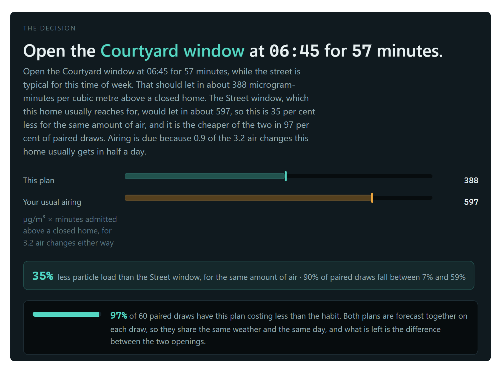
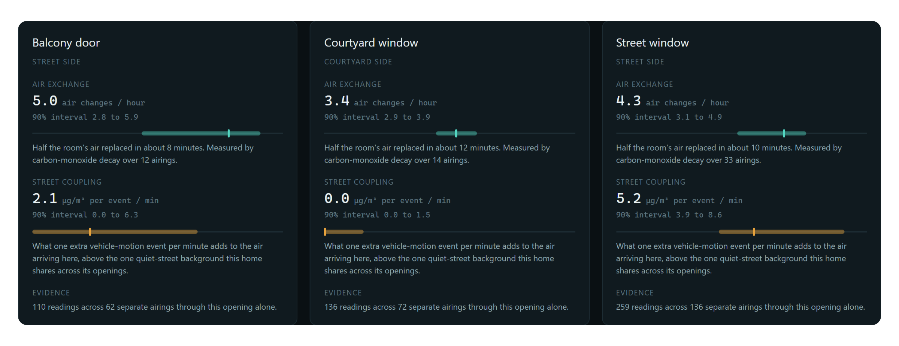
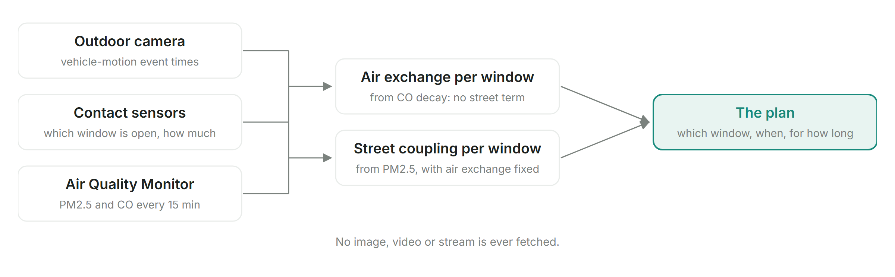
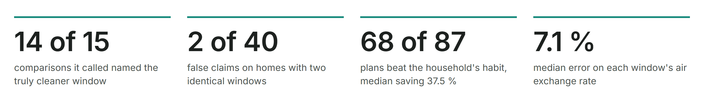
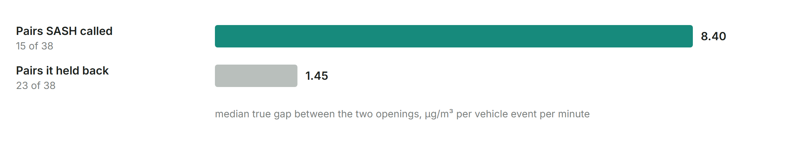

# SASH: Street Air, Sensed at Home

**SASH tells a household which window to open, and when, so the flat gets the
air it normally gets while letting in as little street pollution as possible.**

It runs on Ring hardware a home may already have: an outdoor camera, contact
sensors on the windows, and an Air Quality Monitor. It never looks at an image.

```
Open the Courtyard window at 06:45 for 57 minutes, while the street is typical
for this time of week. That should let in about 388 microgram-minutes per cubic
metre above a closed home. The Street window, which this home usually reaches
for, would let in about 597, so this is 35 per cent less for the same amount of
air, and it is the cheaper of the two in 97 per cent of paired draws.
```

Two windows in the same room can differ by a factor of five in how much
street-linked particulate they admit. No household can know which is which,
because the difference is invisible, it changes with the hour and the weather,
and nobody has an instrument. SASH measures it, from the home's own record, and
then plans around it.

I live in a flat in Strasbourg with one window on a street with traffic and one
on a quieter side, and I have never known which one to open. SASH is the
instrument that answers that.



**Demo video:** <https://youtu.be/ypKJ2x0LNcw>

## For judges

| Criterion | Where to look |
|---|---|
| Tech implementation | The Ring client, webhooks and OAuth in `src/sash/ring/`, pinned to Ring's reference payloads by `tests/test_ring_contract.py`; the SAM stack in `infra/template.yaml`, live at <https://i1jcuqoto7.execute-api.us-east-1.amazonaws.com/dev/>; Amazon Bedrock behind a number guard (`docs/AWS.md`) |
| Design | The screens in [What it does](#what-it-does-in-four-screens), live on AWS; every plan published before the airing and scored after it |
| Potential impact | A non-security use of Ring hardware a household already owns; [Evidence](#evidence): 71 of 94 plans beat the household's habit |
| Quality of the idea | Carbon monoxide from cooking as a tracer gas ([How it works](#how-it-works)); a permutation test before SASH names a better window |

---

## Run it

```bash
git clone https://github.com/Marc-Dvci/SASH
cd SASH
python -m venv .venv && source .venv/bin/activate      # Windows: .venv\Scripts\activate
pip install -e ".[dev]"
sash demo
```

Then open <http://127.0.0.1:8000>.

`sash demo` simulates a household for 120 days, replays its whole history through
the Ring ingest path, and serves the product with the simulated Ring account
still attached. The seeding takes about ninety seconds with a progress bar,
happens once, and is reused on every later run.

No Ring credentials are needed for the demo. `simulator/` is a Ring account: it
serves the documented endpoints as JSON:API compound documents and signs
webhooks with the documented HMAC scheme, so 83,800 signed webhooks go through
`WebhookReceiver` and 21,810 status reads go through `RingClient` before you see
a single number.

Or watch it drive itself, narrated, at <http://127.0.0.1:8000/?demo=1>. That
walkthrough is what the demo video records: it clicks the product's own buttons
and reads the product's own numbers.

Press **Advance 30 min** and Ring events arrive live. Press **Publish this plan**
and then **The household follows it**, and the simulated flat is re-integrated
with that window open, on the same weather and the same street that had already
been drawn, so the plan is scored against the readings that followed.

### Against a Ring account

```bash
export RING_ACCESS_TOKEN=<token from the Ring Developer Playground>
sash spike        # account, devices, every status, two polls of the Air Quality Monitor
sash live         # the product, discovering devices and polling on a five-minute schedule
```

The Playground at <https://developer.amazon.com/ring/console/playground> issues a
token in one click, with no app registration and no subscription. With a
registered app, set `RING_CLIENT_ID`, `RING_CLIENT_SECRET` and
`RING_REDIRECT_URI` instead and the Setup tab offers **Link your Ring account**;
`/ring/link` sends the household to Ring's consent page and `/ring/callback`
exchanges the code. Webhooks arrive at `POST /ring/webhook`.

Other commands:

```bash
sash fit                        # print the fitted household model as JSON
sash serve                      # serve an existing database
sash bench --homes 24 --nulls 40 --days 120     # the benchmark below
pytest                          # 155 tests
```

---

## What it does, in four screens

**Now.** The decision. One opening, one start time, one duration, with the
predicted intake, the comparison against what this household would have done
anyway, and the share of paired bootstrap draws in which the plan really is
cheaper. Under it, every plan that was considered and rejected.



**Windows.** Per opening: air exchange rate, street coupling, both with
intervals, and the evidence behind each. Above them, the verdict, which is
sometimes **"these two openings are not yet distinguishable"**.

**Timeline.** Indoor PM2.5, the street's traffic, which openings were open, and
where an indoor emission was detected, on one axis.

**Record.** The accountability screen. A held-out replay of the home's own
record, priced before the fact, and the ledger of plans published in this
session, scored against what the readings afterwards actually showed.

**Setup.** Device mapping, health checks, account linking, and a panel listing
what SASH reads and what it never requests.

---

## How it works



Three Ring streams and nothing else: vehicle-motion event **times** from a
camera, contact transitions from the windows, and a four-channel Air Quality
Monitor reporting every fifteen minutes.

**The measurement problem.** Each opening has two unknowns: how fast it moves air
(the benefit) and how dirty the air it moves is (the cost). On fifteen-minute
particle readings those two trade off badly, because a small window onto a filthy
street looks like a large window onto a clean one.

**The idea.** Carbon monoxide has no street term. Outdoor CO in a residential
street is negligible next to indoor combustion, so between cooking events the CO
channel is a decaying tracer, and regressing its decay constant on how open each
window was gives that window's air exchange rate directly. This is tracer-gas
decay, the standard building-science method for measuring ventilation, which
normally needs a technician and a cylinder of tracer gas. The household generates
the tracer twice a day by cooking, and Ring already measures it.

With the exchange rate known, the particle channel has one unknown left, and that
is the street coupling.

**The refusal.** Before SASH names a better window, every airing is held exactly
as it happened and only the label is shuffled. If the difference does not survive
that, SASH says so. On 40 simulated households whose two openings are physically
identical, it announced a difference on 2 of them, at a nominal 5%.

`docs/MODEL.md` is the full account.

---

## Evidence





`sash bench` simulates households SASH has never seen, hands it nothing but the
streams a Ring account would deliver, and scores it against the simulator's own
physics. Full results in `docs/BENCHMARK.md` and `bench/results/`.

| | |
|---|---|
| Air exchange rate recovered to | 7.1% median relative error |
| Street coupling recovered to | 1.06 ug/m3 per event/min median absolute error |
| Recommendations that really did beat the household's habit | 71 of 94 |
| Median realised saving on those | 44.5% |
| False claims on 40 households whose openings are identical | 2, at alpha = 0.05 |
| Coverage of the 90% prediction interval, 3,517 held-out airings | 88.6% |

One airing has a median true cost of 682 and a median forecast error of 354, and
the benchmark says where that width comes from: substituting the street's actual
traffic or the day's actual outdoor air moves it by under 10%, so a single
airing is a small signal on a fifteen-minute cadence. That is why SASH's claim is
a **comparison between two openings on the same day**, where those terms cancel.

---

## Privacy

SASH is built on a camera and never looks at what the camera sees.

Ring's Cameras and Doorbells scope carries the media endpoints together with the
motion events SASH needs, so a household granting access is granting more than
this product uses. The product enforces the difference:

- The client carries a **path allowlist** of ten entries. Any media path raises
  before a socket is opened.
- `tests/test_no_media.py` walks every documented media path against a simulator
  that **does implement them and would answer**, and asserts the client refuses
  before the transport is touched.
- Human motion is delivered by Ring and **discarded at the door**: 10,300
  discarded against 72,099 vehicle events on the demo home's 120 days. A record
  of when a household comes and goes is exactly what this product must not keep.

`docs/PRIVACY.md` lists every field stored.

---

## On AWS

The same product runs as a SAM stack, deployed in `us-east-1`:

<https://i1jcuqoto7.execute-api.us-east-1.amazonaws.com/dev/>

API Gateway hands each Ring webhook to a Lambda that verifies the signature,
deduplicates on `meta.request_id` with a conditional write and answers inside
Ring's five-second budget; SQS carries the event to a processor Lambda; a
scheduled Lambda polls the Air Quality Monitor; DynamoDB holds the record; the
product half is the same FastAPI app behind Mangum. `docs/AWS.md` has the
template, the verification against the live stack, and the Bedrock adapter that
phrases the decision card.

---

## Repository

```
src/sash/
  ring/          Ring client with the media allowlist, webhook verification, OAuth
  ingest.py      Event processor, queue, Air Quality Monitor poller, discovery
  live.py        The product against a Ring account: token, discovery, poller
  analytics/     intervals, sources, estimator, nulls, activity, planner, holdout
  service.py     One cached household view behind every route
  api.py         FastAPI: /ring/webhook, /ring/link, /ring/callback, /api/*
  aws/           Lambda handlers and the DynamoDB store
  web/           Five views, no framework, no build step
simulator/       A Ring account: ground-truth physics, the documented endpoints,
                 and a replay through the real ingest path
infra/           The SAM template and the table seeder
bench/           The benchmark and its results
tests/           155 tests, including Ring's own reference payloads verbatim
docs/            MODEL, ARCHITECTURE, PRIVACY, RING_API_NOTES, BENCHMARK, AWS,
                 FRICTION_LOG, PRODUCT_FEEDBACK, DEMO_SCRIPT, JUDGE
```

## Demo video

<https://youtu.be/ypKJ2x0LNcw>, under three minutes. Built by `demo_video/narrate.py` and
`demo_video/record.py` around the walkthrough that ships in the product, so it is
a recording of SASH rather than an animation of it. English subtitles in
`demo_video/demo_subtitles.srt`.

## Status

Built during the Amazon Developer Hackathon, September 2026, for the **Ring
track**, with the AWS Builder and Open Source mini challenges. Licensed
Apache-2.0.
